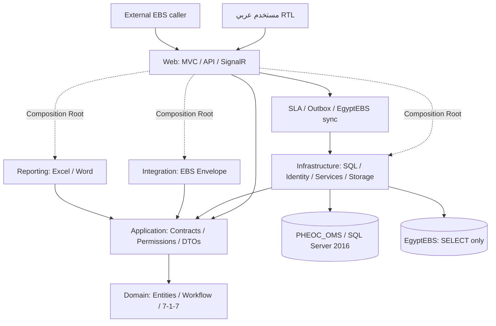

# المعمارية التقنية المطبقة

التاريخ: 2026-11-05. Modular Monolith مبني باستخدام ASP.NET Core MVC وEF Core/Identity وSQL Server 2016. المخطط الأولي التاريخي محفوظ في InitialArchitecturePlan.md.

## الحدود والاعتمادات

Domain لا يعتمد على EF أو MVC أو Identity. Application يحمل العقود ومدخلات التحقق والصلاحيات. Infrastructure يطبق الخدمات ويستخدم EF وSQL وIdentity وحماية Inbox والمرفقات. Integration يحمل عقد استقبال EBS؛ موصل القراءة في Infrastructure بسبب ارتباطه بالمخطط الفعلي وSqlClient. Reporting يعتمد على العقود وClosedXML دون مرجع إلى DbContext. Web يجمع التطبيقات في DI ويستضيف العمال.

الخدمات التشغيلية مقسمة إلى ملفات partial حسب الوحدة، مع Demand للصلاحية وScope للمحافظة وLoad/Open للحدث. Controllers لا تمرر EF entities إلى Views. القراءة بصفحات وحدود، والاستعلامات الحساسة لا تحمل بيانات المبلغين من EBS.

## معاملات وثبات البيانات

- SaveChangesAsync يتحقق من السجلات الدفترية ويضيف Audit داخل المعاملة نفسها بعد معرفة المفاتيح الفعلية.
- تغير الحدث يحدّث ModifiedAt لتغيير RowVersion ومنع تعارض عمليات فرعية مع الإغلاق.
- Inbox يستخدم أقفال sp_getapplock على مفتاح الرسالة ومعرف الحدث بترتيب ثابت، وقيود SQL فريدة وإعادة محاولة محدودة للأخطاء العابرة. الحفظ يشمل Inbox/الحدث/Timeline/Outbox.
- المخزون والنشر والتحويل والإغلاق بمعاملات وتحقق RowVersion. لا HTTP خارجي داخل معاملة SQL.
- القرارات والتقييمات والسياسات وحركات المخزون وأدلة KPI append-only؛ التصحيح قيد جديد أو سياسة بإصدار جديد. اعتماد طلب الإغلاق حقل مسموح بعد فحص الشروط.
- تقارير SitRep تحفظ snapshot وإصداراً ومعداً ومعتمداً مختلفاً.

## الوقت والمؤشرات

الطوابع الزمنية UTC والعرض بتوقيت مصر وفق TimeZoneInfo دون إزاحة ثابتة. مدخلات datetime في النماذج موسومة UTC. تواريخ KPI من نوع date/DateOnly، وتُحفظ أدلتها منفصلة عن حقول المصدر، فلا يصبح استلام PHEOC إخطاراً تلقائياً.

7-1-7 بحساب فرق التواريخ، وآخر مرحلة عبر جميع الإجراءات المنطبقة، مع تمييز N/A عن التاريخ المجهول. يستخدم أحدث قيد موثق مع بقاء القيود السابقة؛ النسخة `717-alliance-2024/date-difference-v1`. لا يحسب نقص البيانات كنجاح. SLA الداخلي بالدقائق، وتعريفاته بإصدارات ترتبط بالأحداث الجديدة وقت الاستلام، فلا تتغير أهداف الحدث التاريخية عند إضافة نسخة جديدة.

معاينة تواريخ EgyptEBS (`source-map-v2`) مستقلة عن حساب المؤشر: قراءة مفوضة وفق الحدث ومن اتصال المصدر الحالي، ثم استخدام اختياري للتواريخ في الحقول الفارغة مع مصدرها وحفظ قيد موثق بالمراجعة. لا تكتب عملية GET ولا تعدّل التوثيق السابق أو الاستبعاد. EventStartDate مرشح للنشوء وليس اعتماداً تلقائياً، وDetectionDate للاكتشاف؛ أقدم Responses.CreatedAt غير محذوف يمثل الإخطار وفق توضيح المستخدم الأخير، ويُحفظ رقم سجل المصدر وطابعه الزمني في دليل القيد. عند غيابه يبقى الإخطار مجهولاً. لا يُستخدم لتحديد أي من الإجراءات السبعة. لا تغيير لصيغة الحساب أو المخطط.

## التكامل والمهام

قارئ EgyptEBS مستقل بصلاحيات SELECT فقط على عشرة جداول. لا يغير المصدر ولا يعيد أعداداً غير متاحة فيه. الاستيراد اليدوي متاح، والتلقائي اختياري بنقطة بدء محفوظة. تعاد معالجة الفشل دون تقدم صامت، وتمنع هوية المصدر التكرار. لا تُستبدل لقطات المصدر تلقائياً عند تغيره.

Outbox بنمط at-least-once؛ يمتلك العامل الرسالة مؤقتاً بتحديث ذري لموعد المحاولة، ويرسل مع MessageId ثابت. دون CallbackUrl تظل Pending، ولا تصبح Sent إلا بقبول HTTP. لا يعني ذلك التسليم النهائي. SignalR يرسل إشعار تحديث إلى مجموعة مركزية أو محافظة وفق صلاحية الاتصال.

SLA يعمل دورياً بدفعات مرتبة حسب آخر تقييم لمنع تجويع السجلات، ويوثق التصعيد حتى ثلاثة مستويات. العمال لا يهيئون المخطط عند بدء التشغيل.

## الواجهة وPWA

Razor وCSS محلي، RTL ومتجاوب، دون Bootstrap أو CDN. Leaflet وحدود Natural Earth محلياً. خرائط المحافظات التفصيلية وتتبع الفرق تحتاج بيانات جغرافية وموقعاً معتمداً؛ لا تُختلق إحداثيات.

Service Worker يحفظ shell ثابتاً وصفحة انقطاع فقط. المسودات الميدانية اختيارية ومشفرة ومحدودة بعلامة التبويب؛ المزامنة صريحة وتفوض على الخادم وتستخدم ClientRequestId ثابتاً. هذا لا يمثل تطبيق ميدان كاملاً يعمل دون أي اتصال سابق.

## التشغيل والحماية

User Secrets للتطوير وEnvironment Variables للإنتاج. حساب التهيئة منفصل عن حساب التشغيل. SQL provider مضبوط على مستوى 130، وفُحصت العمليات على المحرك 13.0.1601.5 فعلياً. لا migrations عند بدء التشغيل؛ تُنفذ بأمر CLI صريح. حزمة Windows مستقلة مع Runtime 10.0.13، وIIS والنسخ والاستعادة والمزودات الخارجية خطوات نشر مستقلة موثقة ولم تُعتمد إنتاجياً.
عنوان خادم EgyptEBS قابل للتعديل من الشاشة للمسؤول المركزي فقط. IEgyptEbsConnectionSource يركب DataSource من مخزن العنوان المحلي فوق اتصال التشغيل الآمن عند فتح الاتصال، مع بقاء القاعدة وخصائص الأمان والاعتماد. اختبار SELECT لمخطط الجداول يسبق الحفظ. المصدر اليدوي والتلقائي يستخدمان المزود نفسه. تفاصيل المخزن والنشر في [EgyptEbsServerSettings.md](EgyptEbsServerSettings.md).

يمكن حفظ حساب SQL بديل لـEgyptEBS بعد اختبار القراءة؛ تحفظ بياناته كحمولة Data Protection بغرض خاص داخل إعداد الخادم، دون كلمات مرور صريحة أو إعادة عرضها في HTML. مزود الاتصال يفك الحماية في الخادم عند فتح الاتصال. يمكن إلغاء الحساب البديل والعودة إلى اعتماد إعداد التشغيل الأصلي.

صلاحيات المستخدمين الجدد تُحفظ كاختيار صريح مع claim يميّزها؛ UserClaimsFactory يستبدل permission claims الموروثة بالصلاحيات المباشرة للحساب الموسوم فقط. تبقى الحسابات الحالية غير الموسومة على سلوك الوراثة السابق. قوائم الأدوار المقترحة لا تمنح صلاحيات تلقائياً عند الحفظ، ويستمر التحقق على الخادم من الصلاحيات المعروفة والنطاق المركزي. [التفاصيل](RolePermissionDefaults.md).

التصفح التفاعلي لـEgyptEBS منفصل عن ReadChanges الخاص بالعامل. Browse يطبق الفلاتر والصفحات في المصدر بمعاملات SQL، ويستخدم معرفات الاستقبال من Inbox المحلي بمعامل XML، دون استعلام عابر للخوادم أو تخزين المصدر محلياً. يحسب العدد قبل تحديد الصفوف ويجلب تفاصيل الصفحة بعدها. لا تغيير للمخطط أو فهارس المصدر. [التفاصيل](EgyptEbsBrowsing.md).

## QIRA

محرك قرار خالص في Domain يفسر تعريفاً ثابتاً محفوظاً لكل إصدار. IQiraService يعزل MVC عن EF ويفرض النطاق والصلاحيات والنسخ والمراجعة المستقلة. المسودة قابلة للتحرير لقائمها؛ الإكمال يقفل الإجابات والنتيجة، وإعادة التقييم تنشئ إصداراً مرتبطاً. تحفظ التعريفات والمراجع الوطنية والتاريخ دون تعديل. الإجراءات لقطة من المرجع الوطني المرتبط وتتحول بعد الاعتماد إلى مهام ورسالة داخلية؛ لا مزود إرسال خارجي. أُزيل حساب الاحتمال × الأثر من المسار النشط مع إبقاء سجلاته التاريخية للقراءة. [المنهجية والفروع](QiraMethodology.md).

## عرض شجرة QIRA

الشجرة مكون عرض محلي دون مكتبة رسم: Razor ينشئ البطاقات والوصلات من تعريف الخوارزمية المحفوظ، وSVG يرسم الأسهم، وJavaScript يحسب الإحداثيات والملاءمة والاتجاه. QiraTree.Position يحدد الموضع المرئي فقط، ولا يحسب أي نتيجة. ActionTemplates في DTO قراءة لقوالب المرجع المثبت على التقييم، وليست إعداداً جديداً أو تعديل مخطط. تبقى الكتابة والتحقق والصلاحيات في IQiraService. لا تُرسل إجابة إلا للنموذج المحمي الخاص بالسؤال المتاح.
