# تصميم قاعدة البيانات المطبق

آخر تحقق: 2026-11-06. القاعدة PHEOC_OMS على SQL Server 2016 (13.0.1601.5)، مستوى التوافق 130. تم تطبيق سبع migrations، والمخطط يحتوي 58 جدولاً بما فيها __EFMigrationsHistory. المخطط المقترح الأصلي محفوظ في InitialDatabasePlan.md؛ لا يعبر كل جدول فيه عن جدول منفذ.

المصدر التفصيلي: `src/PHEOC.OMS.Infrastructure/Data/OmsDbContext.cs` و`Data/Migrations/`. بيانات تعريف 441 عموداً من القاعدة الحية في [SchemaInventory.tsv](../database/SchemaInventory.tsv)، حيث MaxLength هو sys.columns.max_length بالبايت و-1 يعني max. سكربت SSMS الكامل القابل لإعادة التطبيق حسب تاريخ migrations في [001-InitialSchema.sql](../database/001-InitialSchema.sql).

## الجداول والمفاتيح

| المجموعة | الجداول الفعلية |
| --- | --- |
| Identity | AspNetUsers، AspNetRoles، AspNetUserRoles، AspNetUserClaims، AspNetRoleClaims، AspNetUserLogins، AspNetUserTokens |
| الجغرافيا | Governorates |
| الأحداث والتكامل | Events، EventTimeline، AuditLogs، InboxMessages، OutboxMessages، EbsSyncStates، EventAttachments |
| المخاطر QIRA | QiraDefinitions، QiraNationalPolicies، QiraAssessments، QiraAnswers، QiraActions، QiraHistories |
| أرشيف المخاطر والتفعيل وIMS | RiskPolicies وRiskAssessments للقراءة التاريخية فقط؛ ActivationDecisions، IncidentAssignments، IncidentDecisions، Tasks |
| الفرق | Personnel، Teams، TeamMembers، Deployments |
| اللوجستيات | Warehouses، InventoryItems، InventoryBatches، InventoryTransactions، SupplyRequests، Vehicles، VehicleAssignments |
| الميدان والصحة | FieldReports، Contacts، ContactFollowUps، Samples، SampleTransfers، LaboratoryResults |
| التقارير والإغلاق | SitRepReports، ClosurePolicies، ClosureRequests، AARReviews، ImprovementActions |
| التنسيق | EventMessages، Notifications، NotificationReads، SlaDefinitions، EventSlas، SlaEscalations |
| المؤشرات | KpiDateRecords، EarlyResponseMilestones |
| EF | __EFMigrationsHistory |

الجغرافيا التفصيلية للمصدر لا تُكرر محلياً: يرسم قارئ EgyptEBS شجرة AdministrativeLevels للوصول إلى المحافظة. Districts وOrganizations كجداول محلية مستقلة، وقواميس تشغيل شاملة قابلة للإدارة، ليست منفذة بعد؛ بعض القيم تحفظ كنصوص تشغيلية محددة الطول.

مفاتيح التشغيل bigint identity؛ Governorates بمفتاح int؛ Identity بمفاتيح nvarchar(450). Events.PublicId فريد من نوع uniqueidentifier. العضويات وقراءات الإشعارات مفاتيح مركبة. العلاقات DeleteBehavior.Restrict؛ لا cascade لحذف سجل الحدث.

## العلاقات الرئيسية

```mermaid
erDiagram
    Governorates ||--o{ Events : locates
    Events ||--o{ EventTimeline : records
    Events ||--o{ InboxMessages : originates
    Events ||--o{ OutboxMessages : queues
    Events ||--o{ EventAttachments : attaches
    Events ||--o{ RiskAssessments : assesses
    RiskPolicies ||--o{ RiskAssessments : governs
    Events ||--o{ ActivationDecisions : activates
    Events ||--o{ IncidentAssignments : organizes
    Events ||--o{ IncidentDecisions : decides
    Events ||--o{ Tasks : requires
    Personnel ||--o{ TeamMembers : joins
    Teams ||--o{ TeamMembers : contains
    Teams ||--o{ Deployments : deploys
    Events ||--o{ Deployments : receives
    Deployments ||--o{ FieldReports : reports
    Deployments ||--o{ VehicleAssignments : transports
    Vehicles ||--o{ VehicleAssignments : assigned
    Warehouses ||--o{ InventoryBatches : stores
    InventoryItems ||--o{ InventoryBatches : batches
    InventoryBatches ||--o{ InventoryTransactions : ledger
    Events ||--o{ SupplyRequests : requests
    Events ||--o{ Contacts : follows
    Contacts ||--o{ ContactFollowUps : monitored
    Events ||--o{ Samples : collects
    Samples ||--o{ SampleTransfers : custody
    Samples ||--o{ LaboratoryResults : results
    Events ||--o{ SitRepReports : summarizes
    ClosurePolicies ||--o{ ClosureRequests : governs
    Events ||--o{ ClosureRequests : closes
    Events ||--o{ AARReviews : reviews
    AARReviews ||--o{ ImprovementActions : improves
    Events ||--o{ EventSlas : tracks
    SlaDefinitions ||--o{ EventSlas : versions
    EventSlas ||--o{ SlaEscalations : escalates
    Events ||--o{ KpiDateRecords : dates
    Events ||--o{ EarlyResponseMilestones : evidences
```

## القيود والتزامن

- Inbox فريد على Source + ExternalEventId وعلى Source + IdempotencyKey. الأقفال التطبيقية تستخدم بصمات للمفتاحين قبل القراءة، مع ترتيب ثابت وإعادة محاولة محدودة. لا ينشأ حدث ثانٍ عند التزامن.
- PublicId، EmployeeNumber، PlateNumber وStorageKey فريدة. SitRep فريد EventId + Version، والمخاطر والسياسات بنسخ محفوظة. EbsSyncStates.ConnectorCode فريد.
- عضوية الفريق TeamId + PersonId، وقراءة الإشعار NotificationId + UserId. FieldReports.ClientRequestId فريد عند وجوده لمزامنة الميدان.
- RowVersion لصفوف التشغيل القابلة للتعديل؛ CreatedAt وModifiedAt طوابع UTC. تغير الحدث يحدث ModifiedAt لتفادي تعارض إدخال طفل مع إغلاق الحدث.
- Balance لا يقل عن صفر بقيد SQL، ونسب إنجاز المهام بين 0 و100؛ تحقق الخادم يضيف حدود الأعداد والإحداثيات والتواريخ والصلاحيات وشروط الانتقال.
- المخزون decimal(18,3)، والإحداثيات decimal(9,6)، والنصوص العربية nvarchar. KpiDateRecords وEarlyResponseMilestones تواريخ بلا وقت، منفصلة عن timestamps المصدرية.
- Audit والقرارات والحركات والتقييمات والسياسات والأدلة لا تقبل تعديلاً صامتاً. حساب التشغيل ممنوع من UPDATE/DELETE على الجداول الدفترية المحددة في سكربت التهيئة.

## حماية المصدر والبيانات

EgyptEBS قاعدة مستقلة؛ جدول المصدر لا يدخل migrations التطبيق. لا ينفذ الموصل DDL أو INSERT/UPDATE/DELETE في المصدر. سكربت صلاحيات القراءة إجراء منفصل بعد الموافقة. لم تُنقل بيانات المبلغين أو اتصالاتهم، ولم تُفترض أعداد أو تواريخ إخطار غير موجودة.

ProtectedPayload في Inbox محمي بـASP.NET DataProtection؛ المرفقات على القرص خارج wwwroot ومعها الحجم والبصمة والفاعل في قاعدة البيانات. هذه الضوابط ليست إثباتاً لتفعيل TDE أو تشفير كل الحقول. لا تنفذ إعادة إنشاء للقاعدة أو migrations عكسية أو حذف تاريخ الاختبار دون موافقة ومراجعة واضحة.
## ترقية QIRA — 20261106211504

أضيفت ستة جداول فعلياً بترقية QiraRiskAssessment. QiraAssessments ترتبط بالحدث وتعريف الخوارزمية والمرجع الوطني وبالتقييم السابق؛ فريد EventId+Revision. QiraAnswers فريد AssessmentId+Node مع Active لإبطال الفروع اللاحقة دون حذف، ومرفق اختياري تابع للحدث. QiraActions تحفظ TaskId بعد الإسناد، والمتابعة تقرأ حالة المهمة الحالية. QiraDefinitions تحفظ المحاور والأسئلة والفروع في DocumentJson وبصمتها؛ QiraNationalPolicies تحفظ قوائم الأخطار والإجراءات بإصدارات، دون بيانات افتراضية. QiraHistories تحفظ لقطات التغييرات والفاعل والوقت. أضيف DENY UPDATE/DELETE لحساب التشغيل على التعريفات والسياسات والتاريخ، مع حراسة الإجابات والنتائج المكتملة في DbContext. لم تحذف بيانات المخاطر السابقة أو أي جدول، ولم تتغير EgyptEBS. [التفاصيل](QiraMethodology.md).
