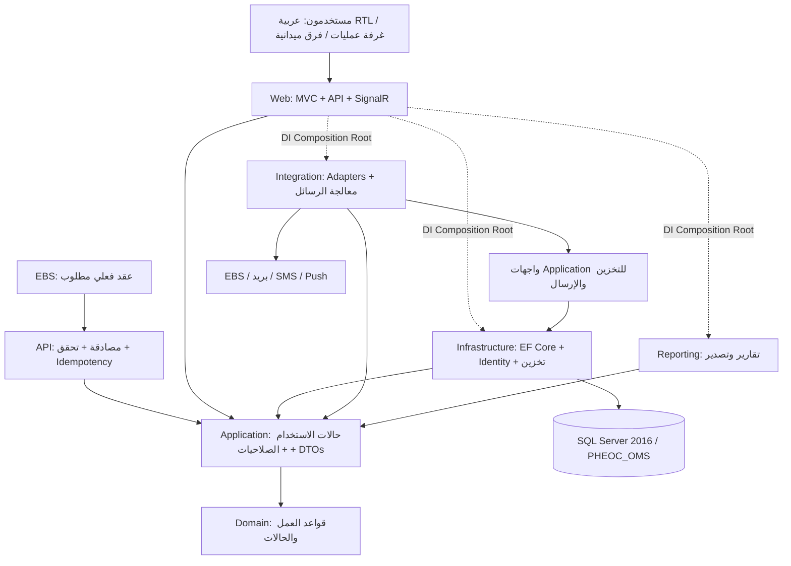

# المعمارية التقنية — PHEOC-OMS

التاريخ: 2026-11-05. الحالة: تصميم مبدئي للمرحلة صفر؛ لا تطبيق منفذ حالياً.

## الهدف وحدود النظام

منصة تشغيل لمركز طوارئ الصحة العامة: استقبال إشارة مؤكدة من EBS، التقييم، قرار التفعيل، إدارة الحادث وIMS، نشر RRT، الموارد والعمليات الميدانية، التقارير، الإغلاق وAAR. تعرض Common Operating Picture مبنياً على بيانات فعلية. ليست سجلاً طبياً للمرضى.

## النمط المعماري

Modular Monolith بمضيف ASP.NET Core MVC واحد وقاعدة SQL Server 2016، مع فصل الوحدات داخل الطبقات. تُعزل التكاملات والتقارير خلف واجهات Application لتسهيل تبديل المزودين دون تغيير قواعد المجال.

الأسهم بين المشاريع تبيّن اتجاه الاعتماد؛ وصول حالات الاستخدام للتخزين أثناء التشغيل يتم عبر interfaces وDI. لا يعتمد Domain على EF أو Identity أو MVC، ولا يتبادل Integration وReporting مراجع مباشرة مع Infrastructure.

## قرارات التقنية

| المجال | القرار المخطط | ما يلزم التحقق منه عند التنفيذ |
| --- | --- | --- |
| Runtime | استهداف .NET 10 بناء على SDK المثبت 10.0.201 | تثبيت SDK في global.json والتحقق من دعم بيئة النشر |
| ORM | EF Core SQL Server من سلسلة متوافقة مع .NET المختار | اختيار إصدار الحزمة ومراجعة SQL Server 2016 وSQL المولد |
| SQL | محرك 2016 وcompatibility level 130 | الإصدار الفعلي والقاعدة والصلاحيات لم تُتحقق عبر اتصال ناجح |
| الهوية | ASP.NET Core Identity + Permission policies | مصفوفة الأدوار والصلاحيات والنطاق الجغرافي/الحدث |
| الواجهة | Razor، CSS محلي، JavaScript، RTL، دون Bootstrap/CDN | الوصولية والاستجابة وملفات خطوط مرخصة محلياً |
| التحديث | SignalR بعد حفظ المعاملة | إعادة الاتصال وإعادة جلب الحالة والتفويض لكل مجموعة |
| المهام | BackgroundService لمعالجة Outbox وSLA | مهلات، قفل/lease، إعادة المحاولة ومنع المعالجة المكررة |
| التسجيل | Serilog مع تنقيح البيانات الحساسة | ترخيص وتوافق الحزم وسياسة الاحتفاظ |
| الاختبارات | xUnit وتكامل SQL وPlaywright | حزم معتمدة وبيئة اختبار مستقلة |
| التصدير | ClosedXML، Open XML SDK؛ مكتبة PDF بعد مراجعة الترخيص | جودة العربية والخطوط والترخيص لكل مكتبة |
| GIS | Leaflet محلي وبيانات جغرافية أو مزود معتمد | مصدر الحدود والترخيص وإتاحة الخرائط دون إنترنت |

لم تُضف أي حزم بعد. لا يُعتبر اختيار المكتبة موافقة على ترخيصها أو إثباتاً لتوافقها.

## الوحدات والتدفقات

الوحدات: Executive Dashboard، Event Intake، Risk Assessment، Activation، IMS، RRT، Logistics، Field Operations، Contacts/Samples، Communications، SitRep، Tasks/Decisions، Closure/AAR. خدمات مشتركة: الهوية، البيانات المرجعية، GIS، التدقيق، المؤشرات، الإعدادات وإصداراتها.

التدفق المبدئي: Received → UnderAssessment → Monitoring أو Activated → ResponseOngoing → Closed. هذه حالات مقترحة من المتطلبات، وليست سياسة تشغيل معتمدة. يُوثق كل انتقال وفاعله وسببه، وتُحدّد صلاحياته وشروطه قبل تنفيذه. الإغلاق الاستثنائي يتطلب اعتماداً مستقلاً ومبررات محفوظة.

## التكامل والموثوقية

1. عقد EBS غير متاح بعد؛ أسماء الحقول والمسارات الواردة في المتطلبات أمثلة تصميمية فقط.
2. اقتراح الاستقبال: `POST /api/integration/ebs/events`، مع HTTPS ومصادقة وتحقق ونطاق مصدر.
3. حفظ Inbox وهوية الرسالة وبصمة المحتوى وإنشاء الحدث والسجل وOutbox في معاملة واحدة.
4. تفرض قيود فريدة على المصدر ومعرف الحدث الخارجي، وعلى المصدر ومفتاح Idempotency. إعادة المفتاح بنفس المحتوى تعيد النتيجة الأصلية؛ اختلاف المحتوى يُرفض كتعارض.
5. المعالجة بنمط at-least-once مع consumers متسامحين مع التكرار، وإعادة محاولات محدودة وتسجيل الفشل النهائي وإعادة تشغيل مراقبة.
6. تحديث الحالة إلى EBS عبر Outbox وAdapter قابل للتهيئة. مقترحا `GET /api/integration/ebs/events/{id}` و`POST /api/integration/ebs/events/{id}/status` يحتاجان حسم الاتجاه والملكية في العقد.
7. لا تُحمّل المرفقات آلياً من URL غير موثوق؛ تُراجع سياسة المصدر والحجم والتفويض وSSRF قبل اعتماد الآلية.

## البيانات والمؤشرات

التخزين UTC والعرض بتوقيت مصر وفق TimeZoneInfo؛ افصل occurrence/detection/notification/verification/confirmation/receipt/response. التاريخ المفقود يُعرض كمفقود مع استبعاده وفق تعريف المؤشر، ولا يستبدل بصفر أو تاريخ الاستلام.

تُحفظ تعريفات KPI وSLA بإصدارات تشمل المصدر، نقطة البداية والنهاية، البسط والمقام والاستبعادات والتقريب. 7-1-7 مستقل عن SLA الداخلي؛ تُعتمد منهجية الحساب ومراحل الاستجابة المطلوبة قبل كتابة الحسابات. تحفظ التقارير المنشورة snapshot ونسخة تعريف المؤشرات.

## الأمن والتشغيل

تفويض حسب Permission والنطاق على الخادم، مع فصل بيانات المخالطين والعينات عن العرض التنفيذي. حماية CSRF وXSS، تحديد معدل API، قفل الحسابات، جلسات آمنة، مرفقات خارج الجذر العام، أسرار خارج الملفات. سجلات القرارات والتدقيق append-only مع حماية صلاحيات SQL؛ الحذف المنطقي ليس بديلاً لحماية التدقيق.

حساب migration منفصل عن حساب التشغيل. لا schema bootstrap عند بدء التطبيق. تُنشر migrations بعد المراجعة والنسخ الاحتياطي واختبار الاستعادة. الخطة المستهدفة IIS وHTTPS ومفاتيح Data Protection محفوظة بأمان ومراقبة صحة التشغيل؛ لم تُنفذ بعد.

PWA مرحلة لاحقة: حد أدنى من البيانات المحلية، سياسة انتهاء ومسح، طابور مزامنة بمعرفات طلبات ثابتة، RowVersion وواجهة حل تعارضات. GPS اختياري، وSOS يتطلب اتصالاً ولا يوصف بأنه تم تسليمه قبل تأكيد ذلك.

## الاعتماديات المفتوحة

- اتصال SQL ناجح للقراءة وفحص وجود قاعدة PHEOC_OMS قبل أي تغيير.
- عقد EBS ومصادقة التكامل وقيم الربط وإدارة المرفقات.
- اعتماد مصفوفات المخاطر والتفعيل والإغلاق والأدوار والنطاقات.
- تعريفات 7-1-7 وSLA وسياسة الخصوصية والاحتفاظ والنسخ والاستعادة.
- تراخيص مكتبات التقارير والخطوط والخرائط وبيانات الحدود.
