# تصميم قاعدة البيانات — PHEOC_OMS

التاريخ: 2026-11-05. تصميم منطقي مقترح، غير مطبق. لم تُنشأ قاعدة أو جداول أو migrations، ولم يُتحقق من وجود القاعدة الحالية بسبب فشل الاتصال الأولي.

## المبادئ والأنواع

- الهدف SQL Server 2016، compatibility level 130. EF Core Code First مع migrations مراجعة وسكربت SQL قابل للمراجعة والتشغيل وفق حالة القاعدة.
- `int` للجداول المرجعية، `bigint` للأحداث والسجلات والرسائل المتنامية. Identity يستخدم مفاتيح `nvarchar(450)` الافتراضية ما لم يُحسم خلاف ذلك قبل أول migration؛ جميع مراجع المستخدم من النوع نفسه.
- معرفات EBS الخارجية نصوص محددة الطول تحفظ القيمة الأصلية؛ لا يُفترض أنها GUID أو رقم. يمكن تخصيص PublicId من نوع `uniqueidentifier` لواجهات النظام.
- النص العربي `nvarchar`، والتوقيت `datetime2(7)` بقيم UTC، والتواريخ الخالية من الوقت `date`، والكميات `decimal(18,3)`، والإحداثيات `decimal(9,6)` مع قيود نطاق.
- `CreatedAt` و`CreatedBy` و`ModifiedAt` و`ModifiedBy` حيث يلزم؛ `rowversion` للكيانات القابلة للتعديل المتزامن. لا يمثل rowversion تاريخاً.
- الحذف المنطقي `IsDeleted` للبيانات المرجعية المناسبة فقط. تمنع السجلات المالية والمخزون والقرارات والتدقيق من الحذف الصامت. تصحح بقيود عكسية أو تصحيحية.
- FK للحفاظ على الترابط وRestrict/NoAction للسجلات التشغيلية؛ لا cascade delete من الحدث إلى التاريخ أو التقارير أو القرارات.
- قيود CHECK للأعداد غير السالبة والإحداثيات ونسبة الإنجاز. انتقالات الحالة وشروط الاعتماد تتحقق في Application داخل معاملة.

## مجموعات الجداول المخططة

| المجال | الجداول | أهم العلاقات |
| --- | --- | --- |
| Security | AspNetUsers، AspNetRoles، AspNetUserRoles، AspNetUserClaims، AspNetRoleClaims، AspNetUserLogins، AspNetUserTokens | جداول Identity القياسية |
| Authorization | UserProfiles، UserAssignments، Permissions، RolePermissions | المستخدم ← ملف وتعريفات نطاق؛ RolePermissions مفتاح مركب RoleId + PermissionId |
| Organization | Governorates، Districts، HealthDirectorates، HealthFacilities، Organizations، Departments | المحافظة ← المناطق والمديريات؛ المنشأة مرتبطة بالمنطقة والجهة |
| Reference | EventTypes، ThreatTypes، RiskLevels، ActivationLevels، TeamTypes، Specialties، Skills، Units | أكواد فريدة وقيم عربية/إنجليزية وحالة تفعيل |
| Events | Events، EventSources، EventTimeline، EventRiskAssessments، EventActivationLevels، EventStatusHistory، EventAttachments، EventLocations | EventSources علاقة الحدث بمصدره الخارجي؛ باقي السجلات تابعة للحدث |
| Risk | RiskMatrixVersions، RiskCriteria، RiskAssessmentAnswers | التقييم مرتبط بنسخة مصفوفة وإجابات ومعتمد |
| IMS | IncidentStructures، IncidentPositions، IncidentAssignments، IncidentMeetings، IncidentDecisions | هيكل للحدث بإصدارات، مناصب هرمية وتعيينات زمنية؛ القرارات تصحح بقيد مرتبط |
| RRT | Personnel، PersonnelSkills، Trainings، PersonnelTrainings، PersonnelSpecialties، Teams، TeamMembers، Deployments، DeploymentOrders، DeploymentOrderMembers، TeamStatusHistory | العضوية مؤرخة؛ أمر النشر يحتفظ بنسخة الأعضاء وقت اعتماده |
| Logistics | Warehouses، InventoryItems، InventoryBatches، InventoryBalances، InventoryTransactions، Suppliers، SupplyRequests، SupplyRequestDetails، Vehicles، VehicleAssignments | الرصيد لكل مستودع ودفعة؛ الحركات دفتر غير قابل للتعديل الصامت |
| Field | FieldMissions، FieldVisits، FieldReports، FieldActivities، FieldCheckIns | المهمة ← الزيارات والتقارير والإجراءات؛ المهمة مرتبطة بالنشر والحدث |
| Contacts | Contacts، ContactPrivateDetails، ContactFollowUps | التفاصيل الشخصية منفصلة ومقيدة؛ المتابعة مرتبطة بمخالط وحدث |
| Samples | Samples، SampleTransfers، LaboratoryResults | العينة ← سلسلة الحيازة والنتائج؛ ربط الشخص اختياري |
| Communications | Notifications، NotificationDeliveries، EventMessages، EventParticipants | إشعار ← محاولات إرسال وتسليم؛ المشاركون ضمن صلاحيات الحدث |
| Tasks | Tasks، TaskAssignments، TaskComments، TaskAttachments | مهمة مرتبطة بحدث وقسم مع تعيينات وتعليقات |
| Reports | SitRepReports، ReportTemplates، ReportTemplateVersions، ReportApprovals | التقرير يحتفظ بالنسخة والبيانات المستخدمة ومعدّه واعتماده |
| Closure | ClosureCriteriaVersions، EventClosureRequests، EventClosureChecks، EventClosureApprovals، AARReviews، AARRecommendations، ImprovementActions | طلب إغلاق ← نتائج الشروط والاعتمادات؛ AAR ← توصيات ← إجراءات |
| System | AuditLogs، IntegrationLogs، InboxMessages، OutboxMessages، SystemSettings، SLADefinitions، EscalationRules، KPIDefinitions، KPICalculationRuns | إعدادات وحسابات بإصدارات؛ رسائل موثوقة مع محاولات المعالجة |

هذه قائمة تصميم أولية، وليست وصفاً لمخطط موجود. يلزم تثبيت حدود العلاقات والحقول لكل وحدة قبل migration الخاصة بها.

## نواة المرحلة الأولى

| الجدول | الحقول الأساسية المقترحة | القيود والفهارس |
| --- | --- | --- |
| Events | Id، PublicId، EventNumber، Title، EventTypeId، ThreatTypeId، GovernorateId، DistrictId nullable، StatusCode، CasesCount nullable، DeathsCount nullable، OccurredAt nullable، DetectedAt nullable، NotifiedAt nullable، VerifiedAt nullable، ConfirmedAt nullable، ReceivedAt، AcknowledgedAt nullable، FirstResponseAt nullable، ClosedAt nullable، RowVersion | PublicId وEventNumber فريدان؛ فهرس GovernorateId + StatusCode + ReceivedAt؛ فهرس ReceivedAt |
| EventSources | Id، EventId، SourceSystem (64)، ExternalEventId (128)، SignalId nullable، InboxMessageId | فريد SourceSystem + ExternalEventId؛ FK EventId وInboxMessageId |
| EventTimeline | Id، EventId، ActionCode، OccurredAt، RecordedAt، ActorUserId nullable، Summary، CorrelationId | EventId + OccurredAt + Id؛ append-only |
| EventStatusHistory | Id، EventId، PreviousStatus، NewStatus، Reason، ChangedAt، ChangedBy | EventId + ChangedAt؛ append-only |
| EventLocations | Id، EventId، GovernorateId، DistrictId nullable، Description، Latitude nullable، Longitude nullable، RowVersion | FK للجغرافيا؛ الإحداثيان معاً أو كلاهما فارغ؛ تحقق المجال |
| EventAttachments | Id، EventId، StorageKey، OriginalName، ContentType، SizeBytes، Sha256، UploadedBy، UploadedAt، ScanStatus | StorageKey فريد؛ لا رابط ملف عام؛ تنزيل مفوض |
| InboxMessages | Id، SourceSystem (64)، IdempotencyKey (128)، PayloadHash، ProtectedPayload، ReceivedAt، Status، Attempts، LastErrorCode، ProcessedAt nullable، EventId nullable، CorrelationId | فريد SourceSystem + IdempotencyKey؛ Status + ReceivedAt؛ سياسة احتفاظ وحماية للـpayload |
| OutboxMessages | Id، MessageId، AggregateId، Type، ProtectedPayload، CreatedAt، NextAttemptAt، Attempts، Status، LockedUntil nullable، LockOwner nullable، SentAt nullable، RowVersion | MessageId فريد؛ Status + NextAttemptAt؛ لا يفترض exactly-once |
| AuditLogs | Id، ActorUserId nullable، Action، EntityType، EntityId، RecordedAt، CorrelationId، RedactedChange | EntityType + EntityId + RecordedAt؛ دون أسرار أو نسخة غير منقحة للبيانات الصحية |

أطوال مفاتيح التكامل محددة لتجنب تجاوز حدود مفاتيح الفهارس؛ تُراجع مقابل العقد الفعلي قبل اعتماد migration. عند اختلاف payload لنفس المفتاح لا تُستبدل الرسالة الأصلية.

## العلاقات الأساسية (ERD مختصر)

```mermaid
erDiagram
    AspNetUsers ||--o{ UserAssignments : scoped_access
    AspNetRoles ||--o{ RolePermissions : grants
    Permissions ||--o{ RolePermissions : defines
    Governorates ||--o{ Districts : contains
    Governorates ||--o{ Events : locates
    Events ||--o{ EventSources : originates_from
    Events ||--o{ EventTimeline : records
    Events ||--o{ EventStatusHistory : transitions
    Events ||--o{ EventLocations : maps
    Events ||--o{ EventAttachments : attaches
    Events ||--o{ EventRiskAssessments : assessed
    RiskMatrixVersions ||--o{ EventRiskAssessments : governs
    Events ||--o{ EventActivationLevels : activated
    Events ||--o{ IncidentStructures : organizes
    IncidentStructures ||--o{ IncidentAssignments : assigns
    Events ||--o{ IncidentDecisions : decides
    Personnel ||--o{ TeamMembers : joins
    Teams ||--o{ TeamMembers : includes
    Events ||--o{ Deployments : receives
    Teams ||--o{ Deployments : deploys
    Deployments ||--o{ DeploymentOrders : authorizes
    Deployments ||--o{ FieldMissions : performs
    Warehouses ||--o{ InventoryBalances : stores
    InventoryItems ||--o{ InventoryBatches : batches
    InventoryBatches ||--o{ InventoryBalances : balances
    InventoryBalances ||--o{ InventoryTransactions : records
    Events ||--o{ Tasks : requires
    Events ||--o{ Contacts : follows
    Contacts ||--o{ ContactFollowUps : monitored
    Events ||--o{ Samples : collects
    Samples ||--o{ SampleTransfers : custody
    Samples ||--o{ LaboratoryResults : results
    Events ||--o{ SitRepReports : summarizes
    Events ||--o{ EventClosureRequests : closes
    EventClosureRequests ||--o{ EventClosureApprovals : approves
    Events ||--o{ AARReviews : reviews
    AARReviews ||--o{ AARRecommendations : recommends
    AARRecommendations ||--o{ ImprovementActions : implements
```

الرسم يوضح العلاقات الرئيسية فقط؛ UserAssignments قد يحمل EventId أو GovernorateId أو OrganizationId وفق نوع النطاق، وتُفرض صحة توليفتها. لا يعني وجود عدة طلبات إغلاق السماح بأكثر من اعتماد فعال متعارض.

## المعاملات والتزامن

| العملية | الوحدة الذرية وآلية الحماية |
| --- | --- |
| استقبال EBS | Inbox + الحدث/المصدر + Timeline + Audit + Outbox داخل معاملة؛ unique constraints تحسم سباق التكرار |
| تغيير الحالة/التفعيل | التحقق من الصلاحية والشروط + RowVersion + حفظ الحالة والتاريخ والقرار وOutbox |
| نشر فريق | إعادة فحص جاهزية الأفراد والفريق والتداخل الزمني داخل المعاملة مع قفل مناسب؛ حفظ snapshot للأعضاء والاعتماد |
| صرف المخزون | تحديث رصيد ذري مشروط بالكفاية مع حركة وتدقيق في المعاملة؛ يمنع سباق الصرف؛ الاستثناء المعتمد محفوظ صراحة |
| تحويل مخزون | خصم وإضافة وحركتان مرتبطتان برقم تحويل واحد داخل معاملة واحدة |
| إغلاق الحدث | تثبيت نسخة معايير الإغلاق وفحص الشروط والاعتمادات والحالة والتدقيق في معاملة؛ منع تغير الشروط أثناء الاعتماد |

يُعاد خطأ تعارض مفهوم عند فشل RowVersion؛ لا overwrite صامت. لا يُجرى اتصال HTTP خارجي داخل معاملة SQL؛ يوضع الإرسال في Outbox.

## توافق SQL والأداء والحماية

لا تستخدم ميزات أحدث من SQL Server 2016 مثل STRING_AGG أو LEDGER أو نوع JSON الأصلي. إن احتجنا JSON يخزن في `nvarchar(max)` مع تحقق مناسب، وتظل الحقول المستخدمة في الربط والبحث أعمدة مطبّعة. يُضبط توليد SQL في provider لمستوى 130 عند التنفيذ ويُختبر على المحرك الحقيقي.

Pagination على الخادم، projections للقراءة، وفهارس حسب مرشحات الاستخدام الفعلية. لا تحمل المرفقات أو payload ضمن استعلامات القوائم. تُراجع execution plans قبل إضافة فهارس واسعة.

تقييد حساب التشغيل ومنع تعديل/حذف دفاتر التدقيق والقرارات إلا بمسار تصحيح مصرح، وفصل حساب migrations. حماية payload والبيانات الشخصية ومفاتيحها مع سياسة احتفاظ معتمدة. النسخ الاحتياطي واختبار الاستعادة متطلب لاحق؛ لم يُنفذا.

## قبل التنفيذ

1. إثبات اتصال قراءة ناجح، وفحص إصدار المحرك ووجود القاعدة ومخططها الحالي دون تغييره.
2. اعتماد عقد EBS وأطوال معرفاته وقيمه وطريقة المصادقة.
3. تثبيت إصدار EF والحزم وإعداد compatibility level وتحديد Identity keys قبل أول migration.
4. توليد migrations وسكربت SQL للمراجعة؛ عند وجود قاعدة سابقة يلزم baseline مدروس، دون EnsureCreated أو إعادة إنشاء.
5. اختبار تطبيق التغييرات على قاعدة اختبار، مع فحوص القيود والتكرار والتزامن والاستعادة قبل النشر.
