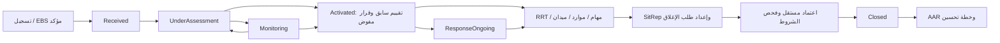

# سير العمل

- نشر الفريق يتطلب تفعيل الحدث وفريقاً جاهزاً بأعضاء متاحين وقائد واحد، ويمنع تداخل تكليف الأفراد.
- الحركة المخزنية تحفظ الرصيد والحركة في معاملة؛ التحويل يحفظ خصماً وإضافة مترابطين.
- القرار لا يعدّل؛ تصحيحه قرار جديد يشير إلى الأصلي. التعيين الجديد ينهي شاغل المنصب السابق مع حفظه.
- الإغلاق يتطلب مستخدماً مختلفاً عن مقدم الطلب، وعودة الفرق والمركبات دائماً؛ الشروط الأخرى حسب نسخة السياسة المحفوظة. قبل أول سياسة تُطبق الشروط الأساسية جميعها.
- لكل تقرير نسخة ولقطة بيانات؛ الاعتماد مستقل عن الإعداد. الإغلاق الاستثنائي لا يعني حذف المهام أو التاريخ.
- KPI يحتفظ بقيود تواريخ وأدلة جديدة عند التصحيح؛ الحساب يستخدم أحدث قيد لكل مفهوم أو إجراء ويُبقي الأصل.
- Inbox يحفظ هوية المصدر ويمنع إنشاء حدث ثانٍ؛ Outbox يبقى Pending دون مزود. Sent قبول HTTP فقط.
